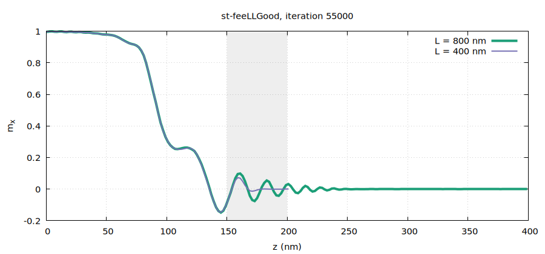
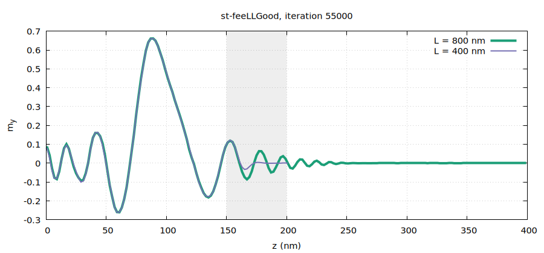
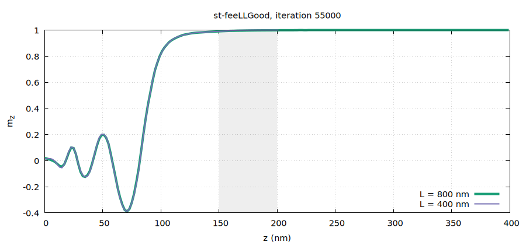
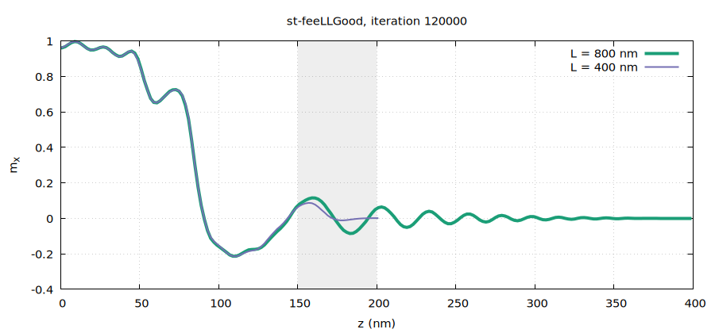
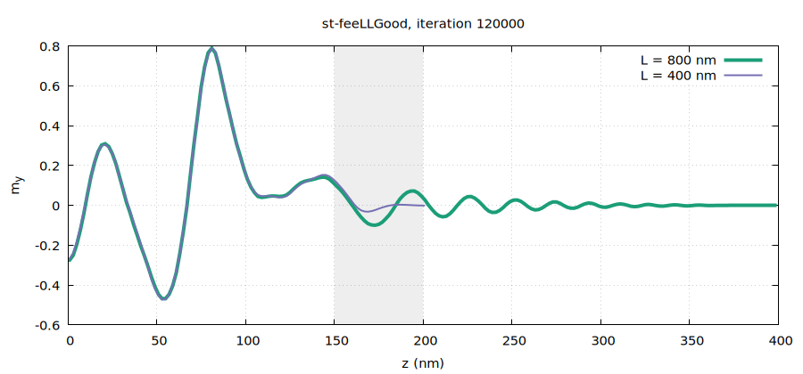
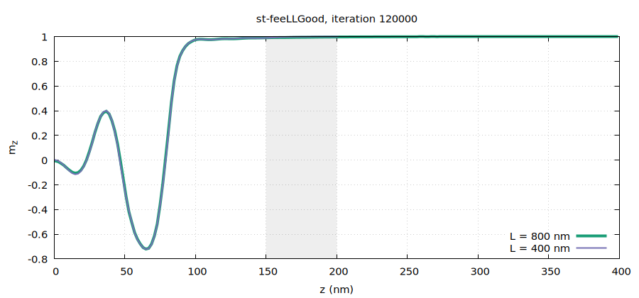

# Study of the effect of an absorbing region on spin waves

## Method

The main idea is to introduce an absorbing region in which the damping factor of the LLG equation
varies from its physical value $\alpha_0 = 0.05$ to its overcritical value $\alpha_{\max} = 1$
according to
```math
\alpha(z) = \alpha_0 + (\alpha_{\max} - \alpha_0)
  \sin^2\!\left(\frac{\pi}{2}\frac{z - z_0}{L_{\text{abs}}}\right),
```
where $z_0$ is the position at which the absorbing region begins and $L_{\text{abs}}$ is its width.
Note that the slope $d\alpha/dz$ vanishes at $z_0$ and at $z_0 + L_{\text{abs}}$.

To qualitatively examine possible reflections caused by the absorbing region, I performed two
simulations on wires with a diameter of 8 nm and lengths $L = 400$ nm and
$L = 800$ nm, taking $L_{\text{abs}} = 50$ nm at each end. At long times I
observe the following distributions.

The initial configuration was a sharp step-like profile: $m_z = 1$ everywhere except for
$z \in [-100, 100]$ nm, where $m_x = 1$. The other components were initially
set to zero.

Good news: according to the figures below, the profiles seem to overlap in the non-absorbing
region, apparently showing no reflection.

However, note that I have only considered a system with a small diameter $D$. For a cylinder with a
larger diameter, it will probably be necessary to use a diagonal damping tensor with
```math
\mathrm{diag}(\alpha) = [\alpha_0, \alpha_0, \alpha(z)].
```

It would also be worth studying the effect of the absorption length $L_{\text{abs}}$.

## Figures

The profiles are averaged over slices of 2 nm along $z$ ($z > 0$; they are symmetric).
Grey: absorbing zone of the 400 nm wire.



*$`x`$ component of magnetization for the wires of lengths $`L = 400`$ nm and
$`L = 800`$ nm.*



*$`y`$ component of magnetization for the wires of lengths $`L = 400`$ nm and
$`L = 800`$ nm.*



*$`z`$ component of magnetization for the wires of lengths $`L = 400`$ nm and
$`L = 800`$ nm.*

Even at long times, no qualitative reflection of spin waves at the wire ends is observed.



*$`x`$ component of magnetization for the wires of lengths $`L = 400`$ nm and
$`L = 800`$ nm.*



*$`y`$ component of magnetization for the wires of lengths $`L = 400`$ nm and
$`L = 800`$ nm.*



*$`z`$ component of magnetization for the wires of lengths $`L = 400`$ nm and
$`L = 800`$ nm.*

## References

1. G. Venkat, H. Fangohr and A. Prabhakar, *Absorbing boundary layers for spin wave
   micromagnetics*, Journal of Magnetism and Magnetic Materials **450**, 34–39 (2018),
   [doi:10.1016/j.jmmm.2017.06.057](https://doi.org/10.1016/j.jmmm.2017.06.057).
