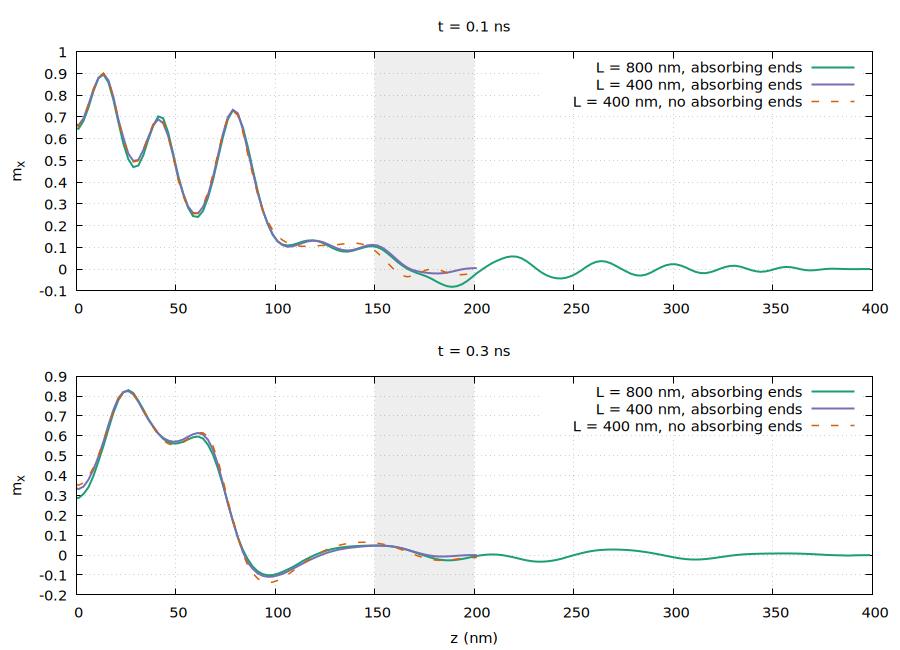

# Study of the effect of an absorbing region on spin waves

## Method

The main idea is to introduce an absorbing region in which the damping factor of the LLG equation
varies from its physical value $\alpha_0 = 0.05$ to its overcritical value $\alpha_{\max} = 1$
according to
```math
\alpha(z) = \alpha_0 + (\alpha_{\max} - \alpha_0)
  \sin^2\!\left(\frac{\pi}{2}\frac{z - z_0}{L_{\text{abs}}}\right),
```
where $z_0$ is the position at which the absorbing region begins and $L_{\text{abs}}$ is its width.
Note that the slope $d\alpha/dz$ vanishes at $z_0$ and at $z_0 + L_{\text{abs}}$.

To qualitatively examine possible reflections caused by the absorbing region, I performed two
simulations on wires with a diameter of 8 nm and lengths $L = 400$ nm and
$L = 800$ nm, taking $L_{\text{abs}} = 50$ nm at each end. At long times I
observe the following distributions.

The initial configuration was a sharp step-like profile: $m_z = 1$ everywhere except for
$z \in [-100, 100]$ nm, where $m_x = 1$. The other components were initially
set to zero.

Good news: according to the figures below, the profiles seem to overlap in the non-absorbing
region, apparently showing no reflection.

However, note that I have only considered a system with a small diameter $D$. For a cylinder with a
larger diameter, it will probably be necessary to use a diagonal damping tensor with
```math
\mathrm{diag}(\alpha) = [\alpha_0, \alpha_0, \alpha(z)].
```

It would also be worth studying the effect of the absorption length $L_{\text{abs}}$.

### Figures

The profiles are averaged over slices of 2 nm along $z$ ($z > 0$; they are symmetric).
Grey: absorbing zone of the 400 nm wire.


*$`x`$ component of magnetization for the wires of lengths $`L = 400`$ nm and
$`L = 800`$ nm.*


*$`y`$ component of magnetization for the wires of lengths $`L = 400`$ nm and
$`L = 800`$ nm.*


*$`z`$ component of magnetization for the wires of lengths $`L = 400`$ nm and
$`L = 800`$ nm.*

Even at long times, no qualitative reflection of spin waves at the wire ends is observed.


*$`x`$ component of magnetization for the wires of lengths $`L = 400`$ nm and
$`L = 800`$ nm.*


*$`y`$ component of magnetization for the wires of lengths $`L = 400`$ nm and
$`L = 800`$ nm.*


*$`z`$ component of magnetization for the wires of lengths $`L = 400`$ nm and
$`L = 800`$ nm.*

## Implementation in feeLLGood

The absorbing ends are enabled by the section `absorbing_ends` of the settings, with the same keys
as in st-feeLLGood:
```yaml
absorbing_ends:
  axis: Z            # axis of the wire: X, Y or Z
  length: 50e-9      # length L_abs of each absorbing zone, in meters
  alpha_max: 1       # damping at the ends of the regions (default 1)
  regions: []        # volume regions whose ends absorb (default: all of them)
  enable: true       # default true when the section is present
```
In Python, `Settings.absorbingEnds(axis, length, alpha_max, regions)` fills this section.

The zones are placed at the two ends of the union of the selected volume regions, not at the ends
of each of them: if $[z_{\min}, z_{\max}]$ is the extent of this union along the axis, computed from
the nodes of the tetrahedrons of the selected regions, the zones are
$[z_{\min}, z_{\min} + L_{\text{abs}}]$ and $[z_{\max} - L_{\text{abs}}, z_{\max}]$, and in each one
```math
\alpha = \alpha_0 + (\alpha_{\max} - \alpha_0)
  \sin^2\!\left(\frac{\pi}{2}\frac{s}{L_{\text{abs}}}\right),
```
in the selected regions only, where $s$ is the depth in the zone ($s = 0$ at its inner boundary,
$s = L_{\text{abs}}$ at the end of the union) and $\alpha_0$ the `alpha_LLG` of the region. The zones and their bounds are printed
at start-up; feeLLGood stops if a listed region is unknown or if the two zones overlap
($2L_{\text{abs}} > z_{\max} - z_{\min}$), and warns if $\alpha_{\max} < \alpha_0$.

The damping is evaluated at each Gauss point of the LLG assembly (`Tet::integrales`), in the
effective damping of the time integration scheme (`calc_alpha_eff`) and in the drift term of the
recentering (`add_drift_BE`). The profile is `AbsorbingEnds::alpha` (`src/absorbing_ends.h`),
checked by the unit test `ut_absorbing_ends`. Without `absorbing_ends`, the results are bit for bit
those obtained before this feature.

### Validation

The study above was repeated with feeLLGood on wires of diameter 8 nm and lengths
$L = 400$ nm and $L = 800$ nm (mesh size 2.5 nm, $J_s = 1.0053$ T,
$A = 1.3 \times 10^{-11}$ J/m, $\alpha_0 = 0.05$, `suppress_charges` on the end faces), with
$L_{\text{abs}} = 50$ nm and $\alpha_{\max} = 1$, and on the 400 nm wire
without absorbing ends. The initial magnetization is the step-like profile of the study.
The profiles are averaged over slices of 2.5 nm along $z$.



*$`x`$ component of magnetization along the wires at $`t = 0.1`$ ns and $`t = 0.3`$ ns ($`z > 0`$; the
profiles are symmetric). Grey: absorbing zone of the 400 nm wire.*

Between the core and the absorbing zone of the short wire ($100 < |z| < 150$ nm), the
reflected waves make the short wire differ from the long one. The rms difference to the
800 nm wire, $\sqrt{\langle |\mathbf{m} - \mathbf{m}_{800}|^2 \rangle}$, is:

| $t$ (ns) | $L = 400$ nm, absorbing ends | $L = 400$ nm, no absorbing ends |
|---|---|---|
| 0.1 | 0.010 | 0.033 |
| 0.2 | 0.016 | 0.031 |
| 0.3 | 0.019 | 0.037 |
| 0.4 | 0.009 | 0.016 |
| 0.5 | 0.012 | 0.017 |

The absorbing ends divide the difference by 1.4 to 3. At later times, both 400 nm
wires drift away from the 800 nm one in the core ($|z| < 100$ nm), with or
without absorbing ends: this drift of the central dynamics, insensitive to the ends, is not a
reflection.

## References

1. G. Venkat, H. Fangohr and A. Prabhakar, *Absorbing boundary layers for spin wave
   micromagnetics*, Journal of Magnetism and Magnetic Materials **450**, 34–39 (2018),
   [doi:10.1016/j.jmmm.2017.06.057](https://doi.org/10.1016/j.jmmm.2017.06.057).
