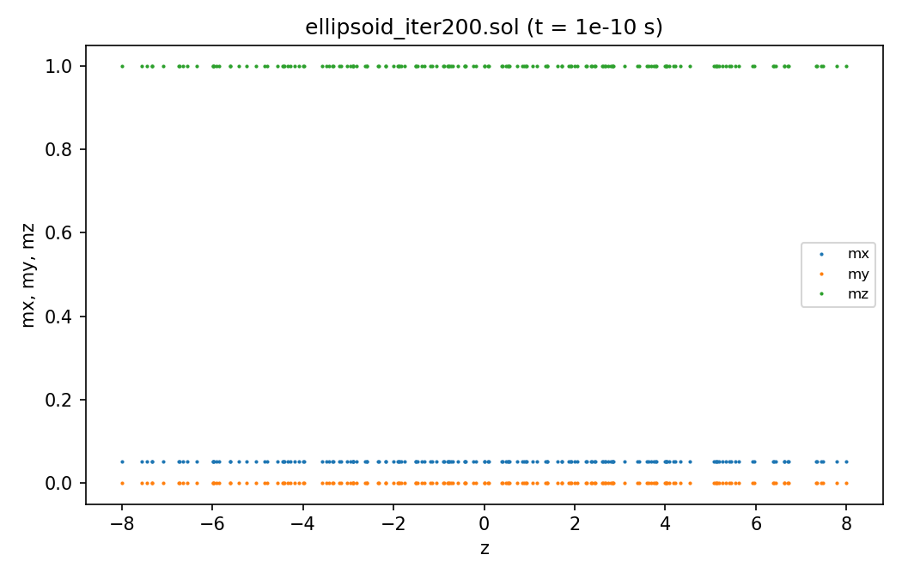
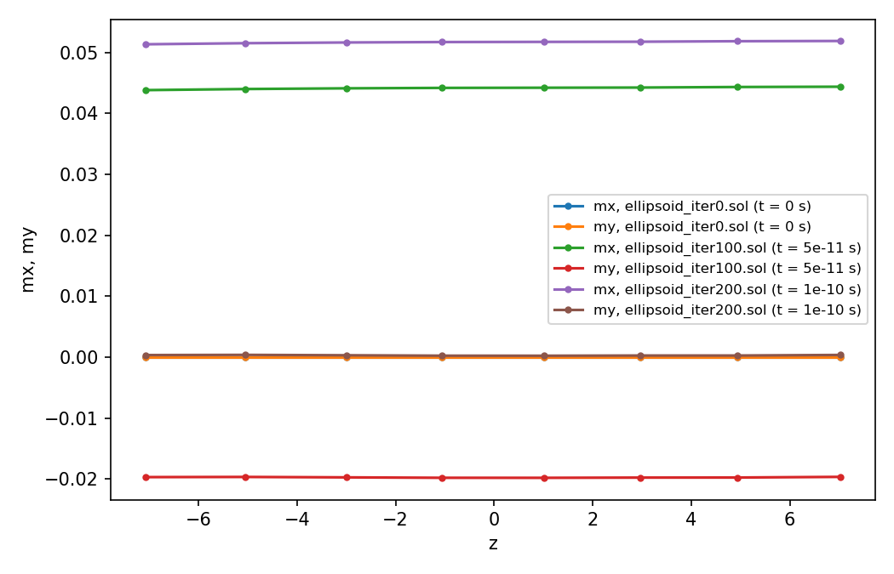
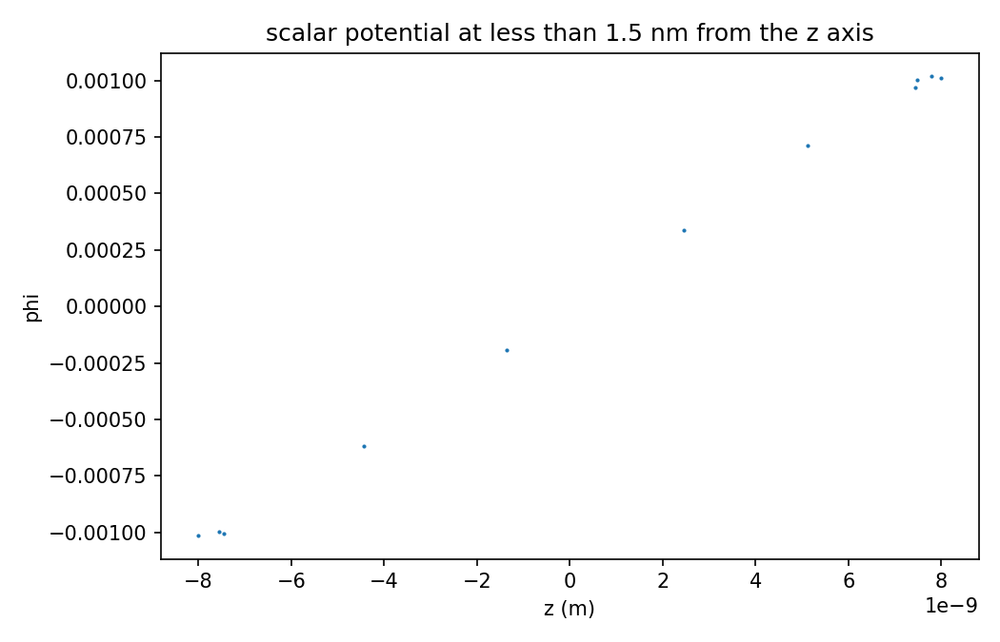
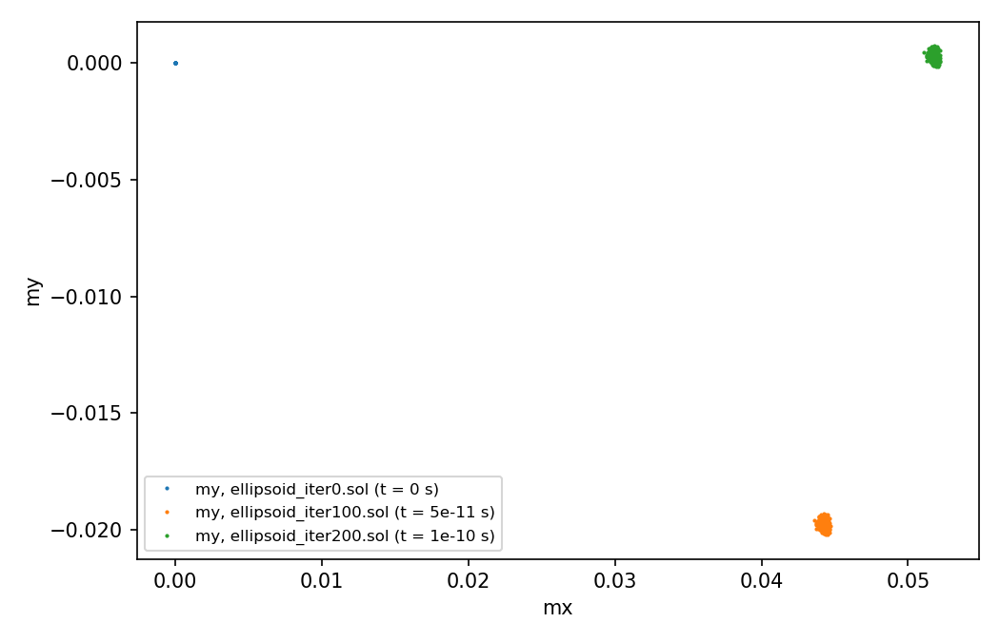
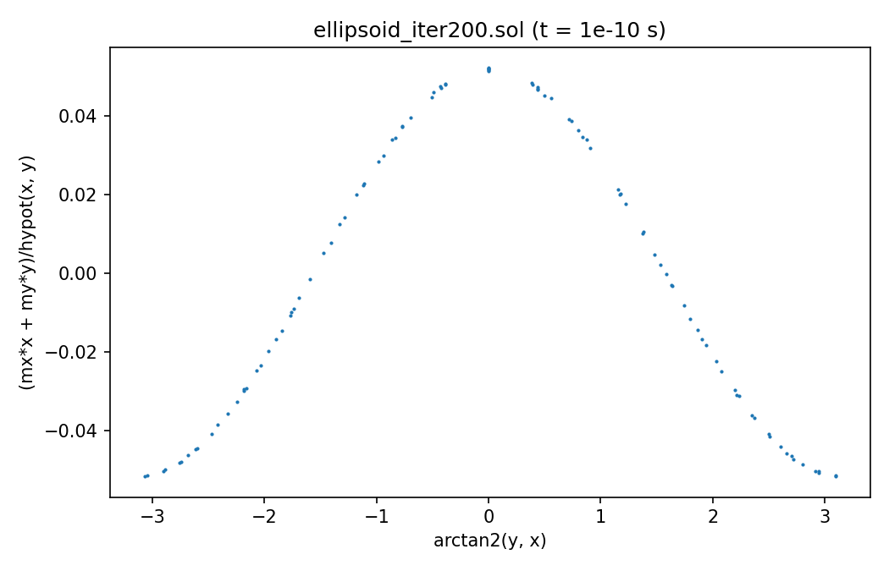

# Plotting `.sol` quantities with `fg-xyplot`

`fg-xyplot` (in `tools/`, installed in `bin/` by `make install`) draws 2D curves from feeLLGood
`.sol` files. On the y axis you put one or several quantities known at the mesh nodes, such as the
magnetization, the magnetic scalar potential, the spin accumulation or the electrostatic potential.
On the x axis you put a coordinate or any other quantity. It complements `fg-plot`, which draws the
magnetization as arrows, and `fg-sol2vtk` + ParaView, which give a full 3D view: `fg-xyplot` is
meant for quick profiles and for comparing several time steps.

This note goes through all its options on the output of `examples/example0.py`.

## The example

`example0.py` relaxes a uniformly magnetized ellipsoid (semi-axes 4, 4 and 8 nm, magnetization
along z at t = 0) in a field `Bext = (0.01, 0, 0)` T, up to the default final time of 1e-10 s:

```sh
cd examples
python3 example0.py
```

With the default settings, the mesh `ellipsoid.msh` is in nanometers (`mesh.length_unit: 1e-9`) and
a magnetization configuration is written every 100 time steps: `ellipsoid_iter0.sol`,
`ellipsoid_iter100.sol` and `ellipsoid_iter200.sol` (t = 0, 5e-11 and 1e-10 s). Each `.sol` file
starts with a header which includes the time and the names of the columns:

```
## time: 1.000000e-10
## columns: idx	mx	my	mz	phi
0	5.1917480e-02	4.2730394e-04	9.9865129e-01	1.0116130e-03
...
```

`fg-xyplot` needs the mesh as well, because a `.sol` file contains the node indices but not their
coordinates. The row `idx` of a `.sol` file is the node with gmsh tag `idx + 1`.

All the commands below are run from `examples/`, with `fg-xyplot` in the `PATH` (otherwise use
`../tools/fg-xyplot`). The script `examples/example0_xyplot.sh` runs the commands that produce the
figures of this note, and writes them to `user-notes/figures/`. `fg-xyplot -h` ends with a short
version of these examples.

## Command line

```
fg-xyplot MESH SOL [SOL ...] -x XEXPR -y YEXPR [YEXPR ...] [options]
```

| option | meaning |
|---|---|
| `MESH` | gmsh mesh file, ASCII format 4.1 or 2.2 (binary files are rejected) |
| `SOL ...` | one or several `.sol` files, all drawn on the same axes |
| `-x`, `--xexpr` | expression for the abscissa (required) |
| `-y`, `--yexpr` | one or several expressions for the ordinate (required) |
| `-f`, `--filter` | boolean expression, in the units of the mesh: only the nodes where it is true are kept |
| `-b`, `--bins` | average the ordinates over this number of equal-width bins of the abscissa |
| `-u`, `--unit` | factor applied to the mesh coordinates in `-x` and `-y`, not in `-f` (default 1) |
| `-o`, `--output` | write the plot to this image file (png, pdf, svg...) instead of showing it |
| `--tsv` | also write the plotted data to this text file |
| `--xlabel`, `--ylabel`, `--title` | axis labels and title |

The plot is shown in a window unless `-o` is given. For each `.sol` file the script prints the
number of nodes kept and, with `-b`, the number of non-empty bins.

## Expressions

`-x`, `-y` and `-f` all take Python expressions, which can use:

- the columns of the `.sol` file, named as in its `## columns:` line: `idx`, `mx`, `my`, `mz`,
  `phi`, plus `sx`, `sy`, `sz` and `V` when the spin accumulation is solved. Because the columns
  are read by name, any column added to the format later is available without changing the
  script;
- the node coordinates `x`, `y`, `z`;
- every numpy function and constant, without the `np.` prefix: `sqrt`, `abs`, `hypot`, `arctan2`,
  `arccos`, `cos`, `pi`... For instance, the distance to the z axis is `hypot(x, y)`, and to the
  x axis `hypot(y, z)`.

Expressions are evaluated on all the nodes at once, so use the Python operators `**`, `&`, `|`,
`~` (not `and`, `or`, `not`). Put any expression that contains spaces, parentheses or `*` in
single quotes, so that the shell does not interpret it. An expression may start with a minus
sign, e.g. `-y '-mx*y/hypot(x, y)'` or `-f '-z > 0'`: it is not mistaken for an option.

## All the nodes against a coordinate

The simplest use draws one point per node:

```sh
fg-xyplot ellipsoid.msh ellipsoid_iter200.sol -x z -y mx my mz -o m_z.png
```



When there is a single `.sol` file, the plot title is its name and its time. With several
ordinates, a legend gives one entry per expression. The magnetization is close to uniform here:
the field along x has tilted it by about 3 degrees from z.

## Profiles: averaging over bins (`-b`)

On an unstructured mesh, several nodes share nearly the same abscissa, so a scatter plot is noisy.
With `-b N`, the range of the abscissa is cut into `N` bins of equal width. In each bin, the
abscissa and every ordinate are averaged, and the result is drawn as a line with markers. Bins
that contain no node are left out. Choose `N` well below the number of nodes along the abscissa:
with this coarse mesh (167 nodes), 5 to 10 bins along z are enough.

## Several time steps

Give several `.sol` files to compare them on the same axes. Each curve is labelled with its
expression, the file name and the time:

```sh
fg-xyplot ellipsoid.msh ellipsoid_iter0.sol ellipsoid_iter100.sol ellipsoid_iter200.sol \
    -x z -y mx my -b 8 -o mxmy_z.png
```



At t = 0 the magnetization is along z (mx = my = 0). At 5e-11 s it precesses around the field and
has a negative my. At 1e-10 s it is nearly relaxed: mx is about 0.052 and my is nearly 0.

The files must all come from the same mesh. The script checks that every `idx` of a `.sol` file is
a node of the mesh and stops otherwise, which catches the most common mistake: a `.sol` file from
another simulation.

## Filtering nodes (`-f`), units (`-u`) and labels

The magnetic scalar potential `phi` of a uniformly magnetized ellipsoid is linear inside it. To
look at it near the long axis, keep the nodes at less than 1.5 nm from the z axis. To get the
abscissa in meters, convert the mesh coordinates with `-u 1e-9`:

```sh
fg-xyplot ellipsoid.msh ellipsoid_iter200.sol -x z -y phi -f 'hypot(x, y) < 1.5' \
    -u 1e-9 --xlabel 'z (m)' --ylabel phi \
    --title 'scalar potential at less than 1.5 nm from the z axis' \
    -o phi_axis.png
```



`-u` only converts the coordinates used in `-x` and `-y`. The filter is always evaluated in the
units of the mesh, nanometers here, so the same filter works with or without `-u`. A filter that
keeps no node stops the script with an error message.

Filters can combine conditions, e.g. `-f '(abs(z) < 2) & (hypot(x, y) > 3)'` for an equatorial
shell, or `-f 'mz < 0'` for the nodes where the magnetization points down.

## Any quantity against any other

The abscissa is not limited to a coordinate. To see where the magnetization of each time step lies
in the (mx, my) plane:

```sh
fg-xyplot ellipsoid.msh ellipsoid_iter0.sol ellipsoid_iter100.sol ellipsoid_iter200.sol \
    -x mx -y my -o my_mx.png
```



Each time step gives a small cloud of points: the magnetization is nearly uniform and moves around
the field direction as a whole.

Expressions can also build derived quantities. Here is the radial component of the magnetization,
`m_r = (mx x + my y) / sqrt(x^2 + y^2)`, against the azimuthal angle, for the nodes close to the
surface (more than 3 nm from the z axis):

```sh
fg-xyplot ellipsoid.msh ellipsoid_iter200.sol -x 'arctan2(y, x)' \
    -y '(mx*x + my*y)/hypot(x, y)' -f 'hypot(x, y) > 3' -o mr_angle.png
```



A magnetization uniform in the plane gives `m_r = m_perp cos(angle - angle_0)`: the curve is a
cosine of amplitude 0.052, peaked at angle 0 because the in-plane component is along x. On the z
axis, `hypot(x, y) = 0` and the expression gives NaN, which matplotlib does not draw; here the
filter keeps only nodes far from the axis anyway.

With the spin accumulation, the same approach gives, for instance, the profile of the transverse
spin accumulation `-y 'sqrt(sx**2 + sy**2)'` or of the electrostatic potential `-y V` along the
current direction.

## Exporting the data (`--tsv`)

`--tsv FILE` writes the data exactly as plotted, after filtering, sorting and binning. There is
one block per `.sol` file, separated by two blank lines (the gnuplot `index` convention). Each
block starts with a `##` header giving the file name, the time and the column names:

```sh
fg-xyplot ellipsoid.msh ellipsoid_iter200.sol -x z \
    -y 'sqrt(mx**2 + my**2)' 'arccos(mz)*180/pi' -b 5 --tsv tilt.tsv -o tilt.png
```

```
## ellipsoid_iter200.sol (t = 1e-10 s)
## columns: z	sqrt(mx**2 + my**2)	arccos(mz)*180/pi
-6.327909596551986482e+00	5.142687197511013053e-02	2.947843131430956998e+00
-3.150430692447045988e+00	5.164320127445811565e-02	2.960254688050840688e+00
-1.139250892269611515e-01	5.174911687089151641e-02	2.966330535055378803e+00
3.004839558949278455e+00	5.179099628178022302e-02	2.968733612545049194e+00
6.209283751905126714e+00	5.187999782988901576e-02	2.973840347280778396e+00
```

The file can then be read by gnuplot, `numpy.loadtxt` or a spreadsheet, for example to overlay an
analytical solution. Without `-o`, `--tsv` still opens the plot window.

## Limitations

- The mesh must be an ASCII gmsh file (format 4.1 or 2.2). Only its nodes are read: elements and
  physical regions are ignored, so a region can only be selected with a geometric filter.
- The values are those at the nodes. There is no interpolation along a line: a "profile" is either
  the set of nodes close to the line (`-f`) or an average over slices (`-b`).
- Bins have equal widths in the abscissa. Their average is unweighted, so it does not take into
  account the volume associated with each node.
